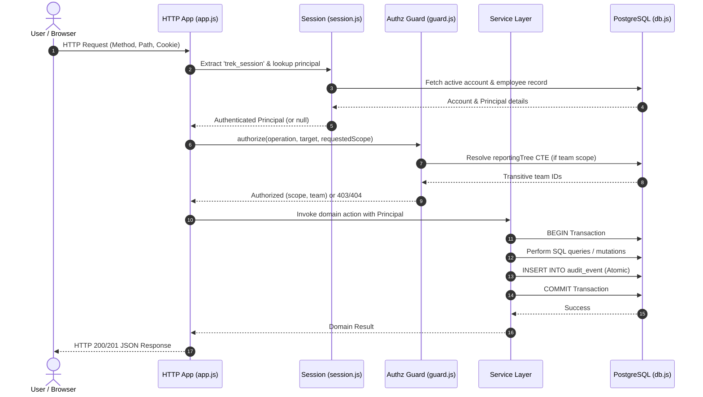

# Trek System Architecture

## 1. High-Level Topology

Trek is designed as a lightweight, zero-framework, serverless-ready web application backed by PostgreSQL. It operates with a minimal runtime footprint while maintaining enterprise-grade transactional and security guarantees.

```mermaid
flowchart TD
    Client["Browser Client\n(HTML5 / Vanilla ES Modules / CSS)"]
    Edge["Platform Edge / Reverse Proxy\n(Vercel or Node HTTP Server)"]
    Router["HTTP Dispatcher\n(src/http/app.js)"]
    AuthGuard["Authentication & Session Layer\n(src/auth/)"]
    AuthzGuard["Authorization & Scope Resolver\n(src/authz/guard.js)"]
    DomainServices["Domain Services\n(Trips, Expenses, Employees, Admin)"]
    DBPool["PostgreSQL Connection Pool\n(src/db.js via pg)"]
    PostgreSQL[("PostgreSQL Database\n(Neon Serverless / Local Postgres)")]

    Client -->|HTTPS / REST| Edge
    Edge --> Router
    Router --> AuthGuard
    AuthGuard --> AuthzGuard
    AuthzGuard --> DomainServices
    DomainServices -->|Transaction tx()| DBPool
    DBPool --> PostgreSQL
```

---

## 2. Architectural Principles

### 2.1 Zero-Framework Philosophy
* **Runtime Simplicity**: Trek relies exclusively on Node.js built-ins (`node:http`, `node:crypto`, `node:fs`, `node:test`) and a single production dependency: **`pg` (node-postgres)**.
* **No ORM**: Raw, parameterized SQL queries are used throughout. This avoids leaky abstractions, N+1 query surprises, and schema migration impedance mismatches.
* **No Frontend Build Step**: The frontend is served directly as vanilla modern JavaScript (`public/app.js`), semantic HTML (`public/index.html`), and scoped CSS (`public/styles.css`). There is no bundler, Webpack, Vite, Babel, or transpilation step.

### 2.2 Dual Runtime Targets
Trek executes identically in two runtime environments:
1. **Local / Container Standalone**: Runs `src/http/server.js` using Node's standard `http.createServer()`.
2. **Serverless (Vercel)**: Runs via `api/index.js`, which exports an entry handler wrapping `src/http/app.js` with serverless connection pooling rules (`DATABASE_POOL_MAX` tuned low).

---

## 3. Request Lifecycle



---

## 4. Key Subsystems

### 4.1 Database Layer (`src/db.js`)
* **Connection Pooling**: Uses `pg.Pool` with SSL assertions (`DATABASE_SSL_MODE`).
* **Date Parsing**: Date types (PostgreSQL OID `1082`) are intercepted to return exact `YYYY-MM-DD` strings, preventing local server timezone offsets from altering calendar dates.
* **Transaction Helper `tx(callback)`**: Manages `BEGIN`, `COMMIT`, and `ROLLBACK` lifecycles automatically on a single checked-out client.

### 4.2 Security & Authorization Layer (`src/authz/`)
* **Declarative Permission Matrix (`permissions.js`)**: Permissions and operations are defined as pure data structures. Handlers never make ad-hoc authorization checks.
* **Reporting Tree CTE**: Resolves an employee's direct and indirect management reporting hierarchy via a recursive common table expression.
* **Opaque Denial**: When a user attempts to access an out-of-scope resource by guessing or substituting an ID, the system returns `404 Not Found` rather than `403 Forbidden` to prevent object enumeration.

### 4.3 Immutable Audit Engine (`src/audit.js`)
* **Append-Only Guarantees**: The `audit_event` table is physically protected in PostgreSQL by database triggers that reject `UPDATE` and `DELETE` operations.
* **Transactional Atomicity**: Audit writes must execute inside the transaction modifying the entity. If business logic fails, the audit row rolls back; if the audit write fails, the entire transaction rolls back.

### 4.4 Financial Accuracy & Money Types
* **Zero Float Math**: Floating-point conversions (e.g., `Number.parseFloat()`) are prohibited for monetary amounts.
* **Storage**: PostgreSQL `NUMERIC(14,2)`.
* **Application Representation**: Strict string decimals validated via `/^\d+(\.\d{1,2})?$/`.
