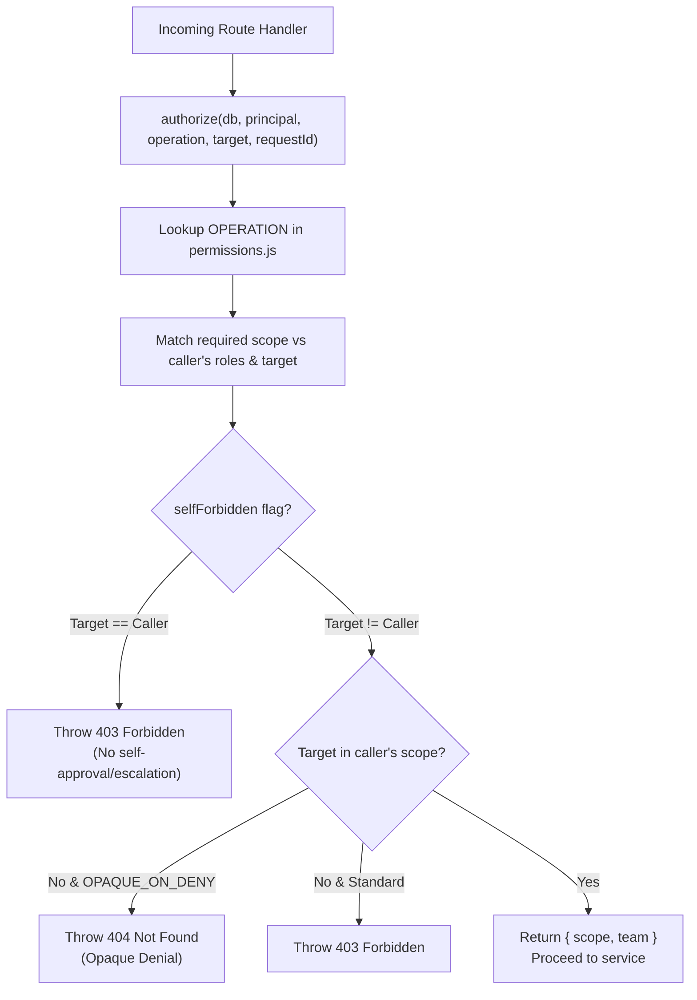

# Trek Authorization, Permissions & Security

## 1. Centralized Authorization Architecture

Trek enforces strict, declarative, server-side authorization. Handler functions **never** write custom `if (user.role === ...)` checks. Instead, every operation is declared in [`src/authz/permissions.js`](file:///Users/ashishreddy/Garageplug/trek-app-personal/src/authz/permissions.js) and resolved centrally in [`src/authz/guard.js`](file:///Users/ashishreddy/Garageplug/trek-app-personal/src/authz/guard.js).



---

## 2. Roles & Permissions Matrix

### 2.1 Role Definitions
* **`employee`**: Base role assigned to every worker. Can draft, view, and submit their own trips and expenses.
* **`manager`**: Management personnel. Can view and decide (approve/reject) trips and expenses submitted by employees in their reporting tree.
* **`hr_travel`**: Travel operations desk. Can read all company travel requests and manage travel bookings.
* **`finance`**: Accounting and finance controllers. Can read company expenses and post accounting settlements.
* **`admin`**: System administrators. Holds company-wide oversight over trips, expenses, approvals, employee directories, departments, and audit logs.

### 2.2 Permissions by Role Table
| Permission | Description | `employee` | `manager` | `hr_travel` | `finance` | `admin` |
| :--- | :--- | :---: | :---: | :---: | :---: | :---: |
| `trip.create` | Create & update draft trips | ✅ | | | | ✅ |
| `trip.read.own` | View own trips | ✅ | | | | ✅ |
| `trip.read.team` | View direct & indirect reports' trips | | ✅ | | | ✅ |
| `trip.read.all` | View all company trips | | | ✅ | | ✅ |
| `trip.approve` | Approve/reject submitted trips | | ✅ | | | ✅ |
| `expense.create`| Create, edit & delete draft expenses | ✅ | | | | ✅ |
| `expense.read.own`| View own expenses | ✅ | | | | ✅ |
| `expense.read.team`| View team reports' expenses | | ✅ | | | ✅ |
| `expense.read.all` | View all company expenses | | | | ✅ | ✅ |
| `expense.approve` | Approve/reject submitted expenses | | ✅ | | | ✅ |
| `employee.manage`| CRUD on employees, bulk import | | | | | ✅ |
| `department.manage`| Manage departments & heads | | | | | ✅ |
| `costcenter.manage`| Manage cost centers | | | | | ✅ |
| `role.manage` | Assign roles to other employees | | | | | ✅ |
| `audit.read` | View the immutable audit log | | | | | ✅ |

---

## 3. Scoping Rules

Every operation that reads or mutates data evaluates a **Scope**:

### 3.1 `own` Scope
* Evaluates: `target.employee_id === principal.employeeId`.
* Used when employees create, read, edit, or submit their own drafts.

### 3.2 `team` Scope (The Reporting Tree)
* **The Rule**: Team scope is **not** based on department membership or office location. It is determined exclusively by the **transitive reporting hierarchy**.
* **Recursive CTE Implementation**:
  ```sql
  WITH RECURSIVE tree AS (
    SELECT id FROM employee WHERE manager_id = $1 AND status = 'active'
    UNION
    SELECT e.id FROM employee e JOIN tree t ON e.manager_id = t.id WHERE e.status = 'active'
  )
  SELECT id FROM tree;
  ```
* **Exclusions**:
  * The manager themselves is **excluded** from their own tree (cannot manage themselves).
  * Department peers are **excluded** unless they report through this manager.

### 3.3 `all` Scope
* Grants organization-wide visibility across all departments and reporting lines.
* Used by Administrators and specialized functional desks (e.g. `trip.read.all`).

---

## 4. Crucial Security Mechanisms

### 4.1 Opaque Denial (`404` vs `403`)
* If an employee tries to access an out-of-scope trip or expense by substituting an ID in the URL (e.g. `/api/v1/trips/trp_other_person`), returning `403 Forbidden` confirms that the record exists, acting as an **enumeration oracle**.
* Trek designates target ID reads as `OPAQUE_ON_DENY`. An unauthorized request returns **byte-identical `404 Not Found`** responses whether the ID belongs to another person or does not exist at all.

### 4.2 Self-Approval & Escalation Prevention (`selfForbidden: true`)
* Managers **cannot** approve their own travel requests or expenses.
* Administrators **cannot** change their own assigned roles (prevents rogue privilege self-escalation).

### 4.3 Brute-Force Rate Limiting
* Failed logins are tracked in `login_attempt`.
* If 5 failed attempts occur within 15 minutes for an email address, login attempts for that email are temporarily blocked (`429 Too Many Requests`).

### 4.4 Append-Only Audit Logging
* Database table `audit_event` is physically secured with PostgreSQL triggers refusing `UPDATE` and `DELETE`.
* All meaningful events (`trip.submit`, `trip.approve`, `trip.reject`, `expense.submit`, `expense.approve`, `expense.reject`, `employee.create`, `role.assign`) must execute `audit()` inside the transaction modifying the entity.
