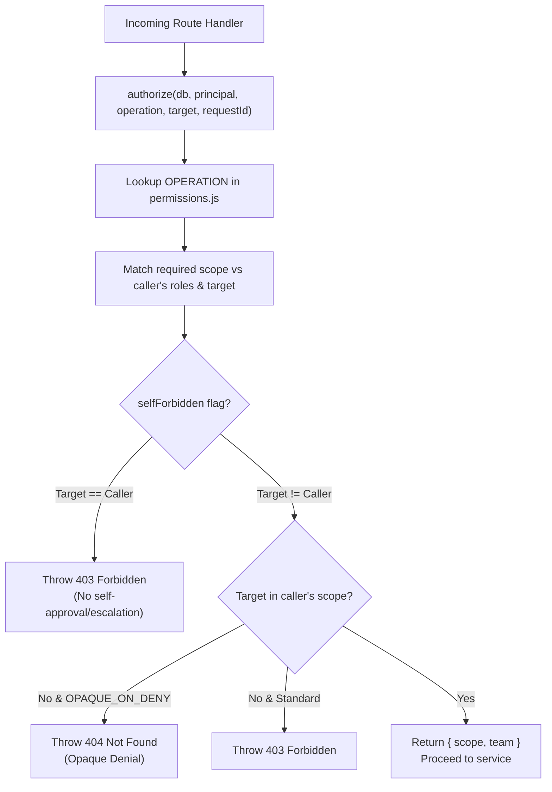

# Trek Authorization, Permissions & Security

## 1. Centralized Authorization Architecture

Trek enforces strict, declarative, server-side authorization. Handler functions **never** write custom `if (user.role === ...)` checks. Instead, every operation is declared in [`src/authz/permissions.js`](file:///Users/ashishreddy/Garageplug/trek-app-personal/src/authz/permissions.js) and resolved centrally in [`src/authz/guard.js`](file:///Users/ashishreddy/Garageplug/trek-app-personal/src/authz/guard.js).



---

## 2. Roles & Permissions Matrix

### 2.1 Role Definitions
* **`employee`**: Base role assigned to every worker. Prepares their own trip budget, records expenses and receipts, and submits for approval.
* **`manager`**: Management personnel. Decide (approve / reject / request changes) trips and expenses submitted by employees **in their reporting tree**.
* **`hr_travel`**: Travel operations desk. Reads all company travel requests and manages travel documents.
* **`finance`**: Accounting and finance controllers. Approve budgets and reconciliations **company-wide**, issue the funds, and post settlements.
* **`admin`**: System administrators. Company-wide oversight over trips, expenses, approvals, employee directories, departments, and audit logs.

### 2.2 The team tier and the company tier are DIFFERENT permissions

This is the most important rule in the matrix, and it is easy to get wrong.

A scope map names the permission required for each scope. If the `all` scope names the *same* permission as the `team` scope, then every holder of that permission satisfies the company-wide branch — and a manager can approve any record in the company, not just their reporting tree. That is not a theoretical concern: it is exactly the bug this split was introduced to fix.

So the matrix carries two permissions per authority:

| Team authority | Company authority | Who holds the company tier |
| :--- | :--- | :--- |
| `trip.approve` | `trip.approve.all` | Finance, Admin |
| `expense.approve` | `expense.approve.all` | Finance, Admin |
| `trip.read.team` | `trip.read.all` | hr_travel, Finance, Admin |
| `expense.read.team` | `expense.read.all` | Finance, Admin |

`test/authz.matrix.test.js` asserts the split: a manager holds the team tier and **does not** hold the company tier.

### 2.3 Permissions by Role Table
| Permission | Description | `employee` | `manager` | `hr_travel` | `finance` | `admin` |
| :--- | :--- | :---: | :---: | :---: | :---: | :---: |
| `trip.create` | Create & update draft trips | ✅ | | | | ✅ |
| `trip.read.own` | View own trips | ✅ | | | | ✅ |
| `trip.read.team` | View direct & indirect reports' trips | | ✅ | | | ✅ |
| `trip.read.all` | View all company trips | | | ✅ | ✅ | ✅ |
| `trip.approve` | Decide trips **in the reporting tree** | | ✅ | | | |
| `trip.approve.all` | Decide any trip company-wide | | | | ✅ | ✅ |
| `trip.budget.manage` | Add & remove budget lines on own trips | ✅ | | | | ✅ |
| `trip.fx.manage` | Set the currency plan on own trips | ✅ | | | | ✅ |
| `trip.fund.manage` | Issue funds against a trip | | | | ✅ | ✅ |
| `trip.reconcile.submit` | Submit own trip for reconciliation | ✅ | | | | ✅ |
| `trip.reconcile.decide` | Approve or send back a reconciliation | | | | ✅ | ✅ |
| `trip.settle` | Record settlement & close the trip | | | | ✅ | ✅ |
| `expense.create`| Create, edit & delete draft expenses | ✅ | | | | ✅ |
| `expense.read.own`| View own expenses | ✅ | | | | ✅ |
| `expense.read.team`| View team reports' expenses | | ✅ | | | ✅ |
| `expense.read.all` | View all company expenses | | | | ✅ | ✅ |
| `expense.approve` | Decide expenses **in the reporting tree** | | ✅ | | | |
| `expense.approve.all` | Decide any expense company-wide | | | | ✅ | ✅ |
| `bill.upload` | Attach a receipt to own expense | ✅ | | | | ✅ |
| `bill.read.own` | View receipts on own expenses | ✅ | | | ✅ |
| `bill.read.all` | View every receipt | | | | ✅ | ✅ |
| `employee.manage`| CRUD on employees, bulk import | | | | | ✅ |
| `department.manage`| Manage departments & heads | | | | | ✅ |
| `costcenter.manage`| Manage cost centers | | | | | ✅ |
| `role.manage` | Assign roles to other employees | | | | | ✅ |
| `audit.read` | View the immutable audit log | | | | | ✅ |
| `report.team` | Team-scoped dashboard and export | | ✅ | | | ✅ |
| `report.finance` | Company-wide dashboard and export | | | | ✅ | ✅ |
| `report.all` | Company-wide dashboard and export | | | | | ✅ |

---

## 3. Scoping Rules

Every operation that reads or mutates data evaluates a **Scope**:

### 3.1 `own` Scope
* Evaluates: `target.employee_id === principal.employeeId`.
* Used when employees create, read, edit, or submit their own drafts.

### 3.2 `team` Scope (The Reporting Tree)
* **The Rule**: Team scope is **not** based on department membership or office location. It is determined exclusively by the **transitive reporting hierarchy**.
* **Recursive CTE Implementation**:
  ```sql
  WITH RECURSIVE tree AS (
    SELECT id FROM employee WHERE manager_id = $1 AND status = 'active'
    UNION
    SELECT e.id FROM employee e JOIN tree t ON e.manager_id = t.id WHERE e.status = 'active'
  )
  SELECT id FROM tree;
  ```
* **Exclusions**:
  * The manager themselves is **excluded** from their own tree (cannot manage themselves).
  * Department peers are **excluded** unless they report through this manager.

### 3.3 `all` Scope
* Grants organization-wide visibility across all departments and reporting lines.
* Used by Administrators and specialized functional desks (e.g. `trip.read.all`).
* **Requires the company-tier permission.** See §2.2.

### 3.4 Collection reads

A list operation has no single target, so "the narrowest scope that covers the target" is meaningless — there is no target. The guard resolves a collection to the widest scope the caller actually holds, and the handler filters by it.

Without this, `GET /api/v1/trips` returned `403` for every employee and manager, because neither the `own` branch (no target to match) nor the `team` branch (no target to look up) could ever fire. The client worked around it by always sending an explicit `?scope=`, which hid the defect from anyone using the API directly.

---

## 4. Crucial Security Mechanisms

### 4.1 Opaque Denial (`404` vs `403`)
* If an employee tries to access an out-of-scope trip or expense by substituting an ID in the URL (e.g. `/api/v1/trips/trp_other_person`), returning `403 Forbidden` confirms that the record exists, acting as an **enumeration oracle**.
* Trek designates target ID reads as `OPAQUE_ON_DENY`. An unauthorized request returns **byte-identical `404 Not Found`** responses whether the ID belongs to another person or does not exist at all.

### 4.2 Self-Approval & Escalation Prevention (`selfForbidden: true`)
* Managers **cannot** approve their own travel requests or expenses.
* Administrators **cannot** change their own assigned roles (prevents rogue privilege self-escalation).

### 4.3 Brute-Force Rate Limiting
* Failed logins are tracked in `login_attempt`.
* If 5 failed attempts occur within 15 minutes for an email address, login attempts for that email are temporarily blocked (`429 Too Many Requests`).

### 4.4 Append-Only Audit Logging
* Database table `audit_event` is physically secured with PostgreSQL triggers refusing `UPDATE` and `DELETE`.
* All meaningful events (`trip.submit`, `trip.approve`, `trip.reject`, `trip.request_changes`, `trip.fund.issue`, `trip.reconcile.submit`, `trip.reconcile.approve`, `trip.settle`, `expense.submit`, `expense.approve`, `expense.reject`, `bill.upload`, `employee.create`, `role.assign`) must execute `audit()` inside the transaction modifying the entity.

### 4.5 Money cannot be claimed against an unapproved trip
* An expense may only be created against a trip in `active` — approved and funded.
* A reconciliation may only be computed when no expense is still awaiting approval, because money in flight would make the balance wrong.
* The workflow's state machine is enforced in the service layer, not in the UI: the API refuses an out-of-order transition with `409 invalid_transition` regardless of what the client offers.

### 4.6 The client is not trusted to hide what it may not do
* The UI hides owner-only actions from people who do not own the trip, but the API enforces it independently. A button that is hidden is a convenience; a button that is refused is the guarantee.

### 4.7 The frontend's contract with the server
* `app.js` and `styles.css` are not fingerprinted, so they are served `no-cache, must-revalidate`. A cached script would outlive the deploy that replaced it and run against a newer API.
* A test asserts that every API path the client calls exists in the server's routing table, and that the HTML carries no manual `?v=` cache-buster that a later deploy would forget to bump.
