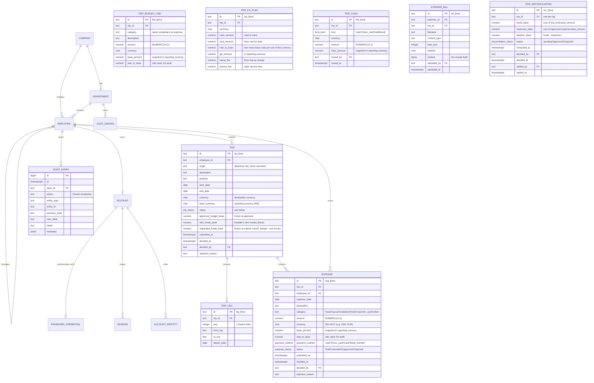

# Trek Data Model & Database Schema

## 1. Entity-Relationship Overview

---

## 2. Table Specifications

### 2.1 Core Identity & Organization

#### `company`
* `id` (`text`, Primary Key, e.g. `'co_trek'`)
* `name` (`text`, NOT NULL)
* `base_currency` (`char(3)`, Default `'INR'`)
* `created_at` (`timestamptz`, Default `now()`)

The company's base currency is stored here and read from here — it is a
setting a company can change, not a constant in the code. Every stored
`base_amount` is in it, which is why a trip spent across several currencies
still has one comparable number.

#### `department`
* `id` (`text`, Primary Key, e.g. `'dep_sls'`)
* `company_id` (`text`, Foreign Key &rarr; `company(id)`)
* `code` (`text`, NOT NULL, Unique)
* `name` (`text`, NOT NULL)
* `head_id` (`text`, Foreign Key &rarr; `employee(id)`, Nullable)
* `active` (`boolean`, Default `true`)

#### `cost_center`
* `id` (`text`, Primary Key, e.g. `'cc_ccsls01'`)
* `company_id` (`text`, Foreign Key &rarr; `company(id)`)
* `department_id` (`text`, Foreign Key &rarr; `department(id)`)
* `code` (`text`, NOT NULL, Unique)
* `name` (`text`, NOT NULL)
* `active` (`boolean`, Default `true`)

#### `employee`
* `id` (`text`, Primary Key, e.g. `'emp_1000'`)
* `company_id` (`text`, Foreign Key &rarr; `company(id)`)
* `employee_code` (`text`, NOT NULL, Unique uppercase, e.g. `'EMP-001'`)
* `name` (`text`, NOT NULL)
* `work_email` (`text`, NOT NULL, Unique lowercase)
* `mobile` (`text`, Nullable)
* `department_id` (`text`, Foreign Key &rarr; `department(id)`)
* `cost_center_id` (`text`, Foreign Key &rarr; `cost_center(id)`)
* `designation` (`text`, NOT NULL)
* `grade` (`text`, Check `grade IN ('G1','G2','G3','G4','G5','G6')`)
* `manager_id` (`text`, Foreign Key &rarr; `employee(id)`, Check `manager_id <> id`)
* `location` (`text`, Nullable, Default `'Not specified'`)
* `joining_date` (`date`, Nullable)
* `status` (`employee_status`: `'active' | 'inactive'`)
* `roles` (`text[]`, Check roles subset of `{'employee', 'manager', 'hr_travel', 'finance', 'admin'}`)

---

### 2.2 Authentication & Sessions

#### `account`
* `id` (`text`, Primary Key, e.g. `'acc_[hex]'`)
* `company_id` (`text`, Foreign Key &rarr; `company(id)`)
* `employee_id` (`text`, Unique, Foreign Key &rarr; `employee(id)`)
* `status` (`account_status`: `'active' | 'suspended'`)
* `last_login_at` (`timestamptz`)

#### `password_credential`
* `account_id` (`text`, Primary Key, Foreign Key &rarr; `account(id)` ON DELETE CASCADE)
* `hash` (`text`, NOT NULL, Scrypt password hash)
* `changed_at` (`timestamptz`, Default `now()`)

#### `login_attempt`
* `id` (`bigserial`, Primary Key)
* `email` (`text`, NOT NULL)
* `ip` (`inet`, Nullable)
* `success` (`boolean`, NOT NULL)
* `at` (`timestamptz`, Default `now()`)

#### `session`
* `id` (`text`, Primary Key, `'ses_' || 16 hex characters`)
* `account_id` (`text`, Foreign Key &rarr; `account(id)` ON DELETE CASCADE)
* `employee_id` (`text`, Foreign Key &rarr; `employee(id)`)
* `token_hash` (`text`, NOT NULL, Unique &mdash; the SHA-256 of the cookie token; the token itself is never stored)
* `method` (`text`, NOT NULL, Default `'email_otp'`)
* `user_agent` (`text`, Nullable)
* `created_ip` (`inet`, Nullable)
* `created_at` (`timestamptz`, Default `now()`)
* `expires_at` (`timestamptz`, NOT NULL)
* `revoked_at` (`timestamptz`, Nullable)

---

### 2.3 Travel & Expense (Pilot Core)

#### `trip`
Represents an employee's business travel request and its budget.
* `id` (`text`, Primary Key, Default `'trp_' || encode(gen_random_bytes(8), 'hex')`)
* `company_id` (`text`, Foreign Key &rarr; `company(id)`)
* `employee_id` (`text`, NOT NULL, Foreign Key &rarr; `employee(id)`)
* `origin` (`text`, Nullable) — the departure city. Deliberately nullable and never defaulted by the server: an assumed origin produces a flight search to the wrong airport.
* `destination` (`text`, NOT NULL)
* `purpose` (`text`, NOT NULL)
* `start_date` (`date`, NOT NULL)
* `end_date` (`date`, NOT NULL)
* `currency` (`char(3)`, NOT NULL, Default `'USD'`, the destination currency)
* `base_currency` (`char(3)`, NOT NULL, Default `'INR'`, the reporting currency)
* `status` (`trip_status`: `'draft' | 'submitted' | 'changes_requested' | 'approved' | 'rejected' | 'active' | 'reconciliation_pending' | 'reconciled' | 'closed'`)
* `approved_budget_base` (`numeric(14,2)`, Nullable) — the budget frozen at approval, so reconciliation compares against what was approved
* `own_funds_base` (`numeric(14,2)`, NOT NULL, Default `0`) — money the traveller already has for this trip, in the company base currency
* `requested_funds_base` (`numeric(14,2)`, Nullable) — the amount the company is asked to fund, frozen at submission as `max(0, budget total - own_funds_base)`
* `submitted_at` (`timestamptz`)
* `decided_at` (`timestamptz`)
* `decided_by` (`text`, Foreign Key &rarr; `employee(id)`)
* `rejection_reason` (`text`, Nullable) — the rejection reason, or what changes were requested
* `created_at` (`timestamptz`, Default `now()`)
* `updated_at` (`timestamptz`, Default `now()`)
* **Constraints**:
  * `CHECK (end_date >= start_date)`
  * `CHECK (own_funds_base >= 0)`
* **Indexes**:
  * `(employee_id, created_at DESC)`
  * `(status)`

An expense may be recorded while the trip is `approved` or `active`; funds do not have to be issued first. Own-funded spend is reimbursed at reconciliation.

#### `trip_leg`
One ordered leg of the itinerary. Legs are replaced as a set — they have no independent identity a user edits one at a time. An empty set is the direct origin → destination journey; a round trip is simply more legs (A→B→C→D→B→A).
* `id` (`text`, Primary Key, Default `'tlg_' || encode(gen_random_bytes(8), 'hex')`)
* `trip_id` (`text`, NOT NULL, Foreign Key &rarr; `trip(id)` ON DELETE CASCADE)
* `seq` (`integer`, NOT NULL) — 1-based order in the itinerary
* `from_city` (`text`, NOT NULL)
* `to_city` (`text`, NOT NULL)
* `depart_date` (`date`, Nullable)
* `created_at` (`timestamptz`, Default `now()`)
* `updated_at` (`timestamptz`, Default `now()`)
* **Constraints**:
  * `CHECK (seq > 0)`
  * `UNIQUE (trip_id, seq)`
* **Indexes**:
  * `trip_leg_trip_idx` on `(trip_id, seq)`

#### `trip_budget_line`
One estimated expense on a trip's budget. The category vocabulary is the SAME as `expense.category`, so budget-versus-actual compares like with like.
* `id` (`text`, Primary Key, Default `'tbd_' || encode(gen_random_bytes(8), 'hex')`)
* `trip_id` (`text`, NOT NULL, Foreign Key &rarr; `trip(id)` ON DELETE CASCADE)
* `category` (`text`, NOT NULL, Check: `'travel' | 'accommodation' | 'food' | 'visa' | 'sim_card' | 'other'`)
* `description` (`text`, NOT NULL)
* `amount` (`numeric(14,2)`, NOT NULL, the amount in `currency`)
* `currency` (`char(3)`, NOT NULL)
* `rate_to_base` (`numeric(20,8)`, NOT NULL) — the rate in force when the line was written
* `base_amount` (`numeric(14,2)`, NOT NULL) — `round(amount * rate_to_base, 2)`, computed in `src/money.js` and snapshotted
* **Constraints**: `CHECK (amount > 0)`, `CHECK (rate_to_base > 0)`

#### `trip_fx_plan`
What the traveller asked for, per currency: cash to carry, forex card to load, the exchange rate, and the charges that come with it.
* `id` (`text`, Primary Key, Default `'fxp_' || encode(gen_random_bytes(8), 'hex')`)
* `trip_id` (`text`, NOT NULL, Foreign Key &rarr; `trip(id)` ON DELETE CASCADE)
* `currency` (`char(3)`, NOT NULL)
* `cash_amount` (`numeric(14,2)`, NOT NULL, Default `0`)
* `card_amount` (`numeric(14,2)`, NOT NULL, Default `0`)
* `rate_to_base` (`numeric(20,8)`, NOT NULL) — how many base-currency units one unit of this currency buys
* `gst_amount` (`numeric(14,2)`, NOT NULL, Default `0`, in base currency)
* `topup_fee` (`numeric(14,2)`, NOT NULL, Default `0`, in base currency)
* `service_fee` (`numeric(14,2)`, NOT NULL, Default `0`, in base currency)
* `note` (`text`, Nullable)
* **Constraints**: all amounts `>= 0`, `CHECK (rate_to_base > 0)`, `UNIQUE (trip_id, currency)`

#### `trip_fund`
What the company actually handed over. The sum of these is what reconciliation compares against the money spent.
* `id` (`text`, Primary Key, Default `'fnd_' || encode(gen_random_bytes(8), 'hex')`)
* `trip_id` (`text`, NOT NULL, Foreign Key &rarr; `trip(id)` ON DELETE CASCADE)
* `kind` (`fund_kind`: `'cash' | 'forex_card' | 'additional'`)
* `currency` (`char(3)`, NOT NULL)
* `amount` (`numeric(14,2)`, NOT NULL)
* `rate_to_base` (`numeric(20,8)`, NOT NULL)
* `base_amount` (`numeric(14,2)`, NOT NULL)
* `note` (`text`, Nullable)
* `issued_by` (`text`, Foreign Key &rarr; `employee(id)`)
* `issued_at` (`timestamptz`, Default `now()`)

#### `expense`
Represents an individual itemized expense incurred during a trip.
* `id` (`text`, Primary Key, Default `'exp_' || encode(gen_random_bytes(8), 'hex')`)
* `company_id` (`text`, Foreign Key &rarr; `company(id)`)
* `trip_id` (`text`, NOT NULL, Foreign Key &rarr; `trip(id)` ON DELETE CASCADE)
* `employee_id` (`text`, NOT NULL, Foreign Key &rarr; `employee(id)`)
* `expense_date` (`date`, NOT NULL)
* `description` (`text`, NOT NULL)
* `category` (`text`, NOT NULL, One of: `'travel'`, `'accommodation'`, `'food'`, `'visa'`, `'sim_card'`, `'other'`)
* `amount` (`numeric(14,2)`, NOT NULL, the amount in `currency`)
* `currency` (`char(3)`, NOT NULL, ISO-4217 code)
* `rate_to_base` (`numeric(20,8)`, NOT NULL) — the rate in force when the expense was written
* `base_amount` (`numeric(14,2)`, NOT NULL) — `round(amount * rate_to_base, 2)`, computed in `src/money.js` and snapshotted
* `payment_method` (`payment_method`: `'cash' | 'forex_card' | 'card' | 'bank_transfer'`, Default `'cash'`)
* `status` (`expense_status`: `'draft' | 'submitted' | 'approved' | 'rejected'`)
* `submitted_at` (`timestamptz`)
* `decided_at` (`timestamptz`)
* `decided_by` (`text`, Foreign Key &rarr; `employee(id)`)
* `rejection_reason` (`text`, Nullable)
* `created_at` (`timestamptz`, Default `now()`)
* `updated_at` (`timestamptz`, Default `now()`)
* **Constraints**:
  * `CHECK (amount > 0)`
  * `CHECK (category IN (...))`
* **Indexes**:
  * `(trip_id, created_at DESC)`
  * `(employee_id, created_at DESC)`
  * `(status)`

#### `expense_bill`
A receipt against an expense. The bytes live in the database: object storage (region, encryption, retention) is an open decision, and a receipt is a few hundred kilobytes.
* `id` (`text`, Primary Key, Default `'bll_' || encode(gen_random_bytes(8), 'hex')`)
* `expense_id` (`text`, NOT NULL, Foreign Key &rarr; `expense(id)` ON DELETE CASCADE)
* `trip_id` (`text`, NOT NULL, Foreign Key &rarr; `trip(id)` ON DELETE CASCADE)
* `filename` (`text`, NOT NULL)
* `content_type` (`text`, NOT NULL, an image type or `application/pdf`)
* `byte_size` (`integer`, NOT NULL, at most 5 MB — enforced by the upload route)
* `sha256` (`char(64)`, NOT NULL, the digest of the bytes)
* `content` (`bytea`, NOT NULL)
* `uploaded_by` (`text`, Foreign Key &rarr; `employee(id)`)
* `uploaded_at` (`timestamptz`, Default `now()`)

#### `trip_reconciliation`
The end-of-trip arithmetic, snapshotted once so a decision is made against a fixed set of numbers.
* `id` (`text`, Primary Key, Default `'rec_' || encode(gen_random_bytes(8), 'hex')`)
* `trip_id` (`text`, NOT NULL, Unique, Foreign Key &rarr; `trip(id)` ON DELETE CASCADE)
* `funds_base` (`numeric(14,2)`, NOT NULL) — sum of `trip_fund.base_amount`
* `expenses_base` (`numeric(14,2)`, NOT NULL) — sum of **approved** `expense.base_amount`
* `balance_base` (`numeric(14,2)`, NOT NULL) — `funds_base - expenses_base`; positive means the traveller returns money, negative means the company reimburses
* `status` (`reconciliation_status`: `'pending' | 'approved' | 'rejected'`)
* `computed_at` (`timestamptz`, Default `now()`)
* `decided_by` (`text`, Foreign Key &rarr; `employee(id)`)
* `decided_at` (`timestamptz`)
* `decision_note` (`text`, Nullable)
* `settled_by` (`text`, Foreign Key &rarr; `employee(id)`)
* `settled_at` (`timestamptz`)
* `settlement_note` (`text`, Nullable)

---

### 2.4 Immutable Audit Log

#### `audit_event`
Append-only log of all security, administrative, and domain operations.
* `id` (`bigserial`, Primary Key)
* `company_id` (`text`, Foreign Key &rarr; `company(id)`)
* `at` (`timestamptz`, Default `now()`)
* `actor_id` (`text`, Foreign Key &rarr; `employee(id)`)
* `actor_label` (`text`)
* `action` (`text`, NOT NULL)
* `entity_type` (`text`, NOT NULL)
* `entity_id` (`text`, NOT NULL)
* `previous_state` (`text`)
* `new_state` (`text`)
* `detail` (`text`, NOT NULL)
* `reason` (`text`)
* `metadata` (`jsonb`, Default `'{}'::jsonb`)
* `request_id` (`text`)
* `actor_ip` (`inet`)
* **Database Triggers**:
  * `audit_event_no_update`: Raises exception on `UPDATE`.
  * `audit_event_no_delete`: Raises exception on `DELETE`.

---

## 3. Migration Register

Migrations are forward-only, sequentially numbered SQL scripts located in `migrations/`.

1. `001_core_identity.sql`: Company, department, cost center, employee, account, and session tables.
2. `002_audit.sql`: Append-only `audit_event` table and PostgreSQL immutability triggers.
3. `003_seed_master_data.sql`: Base organization bootstrap data — company, departments, cost centers, and the two administrators. No demo roster: it was removed at handover rather than created and then deleted.
4. `004_password_auth.sql`: Scrypt credentials, reset tokens, and brute-force tracking (`login_attempt`).
5. `005_remove_demo_employees.sql`: Forward cleanup that removes the legacy demo roster from any database that still carries it, and records an event only when it actually removed something.
6. `006_trips_and_expenses.sql`: Enums, tables, check constraints, indexes, triggers, and runtime role grants for Trips and Expenses.
7. `007_trip_currency.sql`: Adds destination `currency` column to `trip` table for international multi-currency travel planning.
8. `008_optional_employee_fields.sql`: Makes `grade`, `location` and `joining_date` optional on `employee`.
9. `009_budget_funds_bills.sql`: The budget, currency plan, funds, receipts and reconciliation — the rest of the workflow. Also folds the earlier expense categories into the shared vocabulary (`travel`, `accommodation`, `food`, `visa`, `sim_card`, `other`) and adds `payment_method`, `rate_to_base` and `base_amount` to `expense`.
10. `010_currency_registry.sql`: The currency registry and the rates the company remembers. One `currency` list serves both currency pickers, so they cannot drift apart; `exchange_rate` holds one rate per pair per day. It also corrects `company.base_currency` to `INR` — the currency every stored amount is already in — so the setting agrees with the code that reads it.
11. `011_global_currencies_and_rates.sql`: Expands the currency registry to all major global travel destinations (52 currencies total) and seeds standard initial market rates against INR.
12. `012_currency_constraints_and_indexes.sql`: Sets default `company.base_currency` to `INR`, enforces foreign keys from all currency columns to `currency(code)`, and adds an index on `expense_bill(trip_id)`.
13. `013_trip_itinerary_and_funding.sql`: Adds `trip.origin`, `trip.own_funds_base` and `trip.requested_funds_base`, and the ordered `trip_leg` itinerary table with its `(trip_id, seq)` index. Backfills the requested amount for trips that already had an approved budget.

### 3.2 The currency registry

#### `currency`
The currencies Trek knows about. One list, served to the interface, so the
currency pickers are drawn from the same source.

* `code` (`char(3)`, Primary Key, uppercase ISO-4217)
* `name` (`text`, NOT NULL)
* `symbol` (`text`, Nullable)
* `minor_units` (`smallint`, Default `2`) — how many decimal places the currency has
* `active` (`boolean`, Default `true`)

#### `exchange_rate`
The rates Trek remembers. One row per currency pair per day, so entering
today's rate does not erase last week's.

* `id` (`text`, Primary Key)
* `from_code` (`char(3)`, Foreign Key &rarr; `currency(code)`)
* `to_code` (`char(3)`, Foreign Key &rarr; `currency(code)`)
* `rate` (`numeric(20,8)`, NOT NULL, `> 0`) — how many units of `to_code` one unit of `from_code` buys
* `effective_on` (`date`, Default `CURRENT_DATE`)
* `entered_by` (`text`, Foreign Key &rarr; `employee(id)`, Nullable)
* `note` (`text`, Nullable)
* **Constraints**: `UNIQUE (from_code, to_code, effective_on)`

**A remembered rate is a default to offer, never a rewrite.** Every budget
line, expense and fund stores the rate it used (`rate_to_base`) and the
amount it produced (`base_amount`). Changing a remembered rate tomorrow does
not touch money that was already booked, spent or issued.

### 3.1 The money rules

* **No float ever touches a monetary value.** Amounts are `NUMERIC(14,2)`; the base amount is `round(amount * rate_to_base, 2)`, computed once in `src/money.js` (BigInt minor units) and snapshotted on the row. The rounding matches PostgreSQL's `round(numeric, 2)` exactly &mdash; half away from zero, negatives included.
* **Rates are remembered snapshots, never auto-fetched during transactions.** The company records the rates it works with (or synchronizes official reference rates on demand from the European Central Bank via `POST /api/v1/exchange-rates/sync`), one per pair per day, and Trek offers the latest one as a default. Rates are never queried live during transaction recording, and a rate is never applied twice.
* **Every conversion is a snapshot.** Each money row stores the rate it used. Changing the rate later never rewrites money that was already budgeted, spent or issued — the arithmetic stays auditable without the plan's history.
* **Showing money in another currency changes nothing.** A report asked for a display currency produces a second number beside each stored one, with the rate that produced it and the day that rate was effective. The stored amounts do not move.
* **Converted figures are truncated, never rounded.** A converted amount is always equal to or smaller than the money it came from.
* **One vocabulary.** Budget lines and expenses share one category list, so budget-versus-actual compares like with like.
