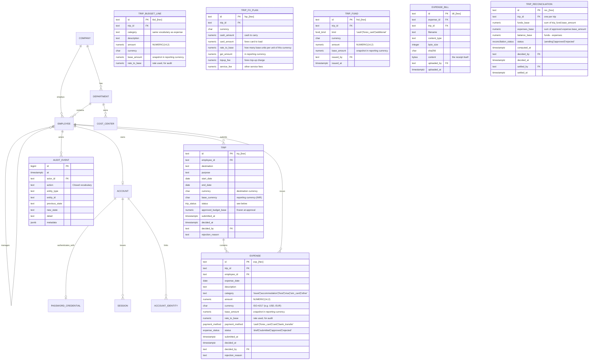

# Trek Data Model & Database Schema

## 1. Entity-Relationship Overview

---

## 2. Table Specifications

### 2.1 Core Identity & Organization

#### `company`
* `id` (`text`, Primary Key, e.g. `'co_trek'`)
* `name` (`text`, NOT NULL)
* `currency` (`char(3)`, Default `'SAR'`)
* `created_at` (`timestamptz`, Default `now()`)

#### `department`
* `id` (`text`, Primary Key, e.g. `'dep_sls'`)
* `company_id` (`text`, Foreign Key &rarr; `company(id)`)
* `code` (`text`, NOT NULL, Unique)
* `name` (`text`, NOT NULL)
* `head_id` (`text`, Foreign Key &rarr; `employee(id)`, Nullable)
* `active` (`boolean`, Default `true`)

#### `cost_center`
* `id` (`text`, Primary Key, e.g. `'cc_ccsls01'`)
* `company_id` (`text`, Foreign Key &rarr; `company(id)`)
* `department_id` (`text`, Foreign Key &rarr; `department(id)`)
* `code` (`text`, NOT NULL, Unique)
* `name` (`text`, NOT NULL)
* `active` (`boolean`, Default `true`)

#### `employee`
* `id` (`text`, Primary Key, e.g. `'emp_1000'`)
* `company_id` (`text`, Foreign Key &rarr; `company(id)`)
* `employee_code` (`text`, NOT NULL, Unique uppercase, e.g. `'EMP-001'`)
* `name` (`text`, NOT NULL)
* `work_email` (`text`, NOT NULL, Unique lowercase)
* `mobile` (`text`, Nullable)
* `department_id` (`text`, Foreign Key &rarr; `department(id)`)
* `cost_center_id` (`text`, Foreign Key &rarr; `cost_center(id)`)
* `designation` (`text`, NOT NULL)
* `grade` (`text`, Check `grade IN ('G1','G2','G3','G4','G5','G6')`)
* `manager_id` (`text`, Foreign Key &rarr; `employee(id)`, Check `manager_id <> id`)
* `location` (`text`, NOT NULL)
* `joining_date` (`date`, NOT NULL)
* `status` (`employee_status`: `'active' | 'inactive'`)
* `roles` (`text[]`, Check roles subset of `{'employee', 'manager', 'hr_travel', 'finance', 'admin'}`)

---

### 2.2 Authentication & Sessions

#### `account`
* `id` (`text`, Primary Key, e.g. `'acc_[hex]'`)
* `company_id` (`text`, Foreign Key &rarr; `company(id)`)
* `employee_id` (`text`, Unique, Foreign Key &rarr; `employee(id)`)
* `status` (`account_status`: `'active' | 'suspended'`)
* `last_login_at` (`timestamptz`)

#### `password_credential`
* `account_id` (`text`, Primary Key, Foreign Key &rarr; `account(id)` ON DELETE CASCADE)
* `hash` (`text`, NOT NULL, Scrypt password hash)
* `changed_at` (`timestamptz`, Default `now()`)

#### `login_attempt`
* `id` (`bigserial`, Primary Key)
* `email` (`text`, NOT NULL)
* `ip` (`inet`, NOT NULL)
* `success` (`boolean`, NOT NULL)
* `at` (`timestamptz`, Default `now()`)

#### `session`
* `id` (`text`, Primary Key, 32-byte crypto random string)
* `account_id` (`text`, Foreign Key &rarr; `account(id)` ON DELETE CASCADE)
* `employee_id` (`text`, Foreign Key &rarr; `employee(id)`)
* `created_at` (`timestamptz`, Default `now()`)
* `expires_at` (`timestamptz`, NOT NULL)
* `last_active_at` (`timestamptz`, Default `now()`)

---

### 2.3 Travel & Expense (Pilot Core)

#### `trip`
Represents an employee's business travel request and its budget.
* `id` (`text`, Primary Key, Default `'trp_' || encode(gen_random_bytes(8), 'hex')`)
* `company_id` (`text`, Foreign Key &rarr; `company(id)`)
* `employee_id` (`text`, NOT NULL, Foreign Key &rarr; `employee(id)`)
* `destination` (`text`, NOT NULL)
* `purpose` (`text`, NOT NULL)
* `start_date` (`date`, NOT NULL)
* `end_date` (`date`, NOT NULL)
* `currency` (`char(3)`, NOT NULL, Default `'USD'`, the destination currency)
* `base_currency` (`char(3)`, NOT NULL, Default `'INR'`, the reporting currency)
* `status` (`trip_status`: `'draft' | 'submitted' | 'changes_requested' | 'approved' | 'rejected' | 'active' | 'reconciliation_pending' | 'reconciled' | 'closed'`)
* `approved_budget_base` (`numeric(14,2)`, Nullable) — the budget frozen at approval, so reconciliation compares against what was approved
* `submitted_at` (`timestamptz`)
* `decided_at` (`timestamptz`)
* `decided_by` (`text`, Foreign Key &rarr; `employee(id)`)
* `rejection_reason` (`text`, Nullable) — the rejection reason, or what changes were requested
* `created_at` (`timestamptz`, Default `now()`)
* `updated_at` (`timestamptz`, Default `now()`)
* **Constraints**:
  * `CHECK (end_date >= start_date)`
* **Indexes**:
  * `(employee_id, created_at DESC)`
  * `(status)`

#### `trip_budget_line`
One estimated expense on a trip's budget. The category vocabulary is the SAME as `expense.category`, so budget-versus-actual compares like with like.
* `id` (`text`, Primary Key, Default `'tbd_' || encode(gen_random_bytes(8), 'hex')`)
* `trip_id` (`text`, NOT NULL, Foreign Key &rarr; `trip(id)` ON DELETE CASCADE)
* `category` (`text`, NOT NULL, Check: `'travel' | 'accommodation' | 'food' | 'visa' | 'sim_card' | 'other'`)
* `description` (`text`, NOT NULL)
* `amount` (`numeric(14,2)`, NOT NULL, the amount in `currency`)
* `currency` (`char(3)`, NOT NULL)
* `rate_to_base` (`numeric(20,8)`, NOT NULL) — the rate in force when the line was written
* `base_amount` (`numeric(14,2)`, NOT NULL) — `round(amount * rate_to_base, 2)`, snapshotted
* **Constraints**: `CHECK (amount > 0)`, `CHECK (rate_to_base > 0)`

#### `trip_fx_plan`
What the traveller asked for, per currency: cash to carry, forex card to load, the exchange rate, and the charges that come with it.
* `id` (`text`, Primary Key, Default `'fxp_' || encode(gen_random_bytes(8), 'hex')`)
* `trip_id` (`text`, NOT NULL, Foreign Key &rarr; `trip(id)` ON DELETE CASCADE)
* `currency` (`char(3)`, NOT NULL)
* `cash_amount` (`numeric(14,2)`, NOT NULL, Default `0`)
* `card_amount` (`numeric(14,2)`, NOT NULL, Default `0`)
* `rate_to_base` (`numeric(20,8)`, NOT NULL) — how many base-currency units one unit of this currency buys
* `gst_amount` (`numeric(14,2)`, NOT NULL, Default `0`, in base currency)
* `topup_fee` (`numeric(14,2)`, NOT NULL, Default `0`, in base currency)
* `service_fee` (`numeric(14,2)`, NOT NULL, Default `0`, in base currency)
* `note` (`text`, Nullable)
* **Constraints**: all amounts `>= 0`, `CHECK (rate_to_base > 0)`, `UNIQUE (trip_id, currency)`

#### `trip_fund`
What the company actually handed over. The sum of these is what reconciliation compares against the money spent.
* `id` (`text`, Primary Key, Default `'fnd_' || encode(gen_random_bytes(8), 'hex')`)
* `trip_id` (`text`, NOT NULL, Foreign Key &rarr; `trip(id)` ON DELETE CASCADE)
* `kind` (`fund_kind`: `'cash' | 'forex_card' | 'additional'`)
* `currency` (`char(3)`, NOT NULL)
* `amount` (`numeric(14,2)`, NOT NULL)
* `rate_to_base` (`numeric(20,8)`, NOT NULL)
* `base_amount` (`numeric(14,2)`, NOT NULL)
* `note` (`text`, Nullable)
* `issued_by` (`text`, Foreign Key &rarr; `employee(id)`)
* `issued_at` (`timestamptz`, Default `now()`)

#### `expense`
Represents an individual itemized expense incurred during a trip.
* `id` (`text`, Primary Key, Default `'exp_' || encode(gen_random_bytes(8), 'hex')`)
* `company_id` (`text`, Foreign Key &rarr; `company(id)`)
* `trip_id` (`text`, NOT NULL, Foreign Key &rarr; `trip(id)` ON DELETE CASCADE)
* `employee_id` (`text`, NOT NULL, Foreign Key &rarr; `employee(id)`)
* `expense_date` (`date`, NOT NULL)
* `description` (`text`, NOT NULL)
* `category` (`text`, NOT NULL, One of: `'travel'`, `'accommodation'`, `'food'`, `'visa'`, `'sim_card'`, `'other'`)
* `amount` (`numeric(14,2)`, NOT NULL, the amount in `currency`)
* `currency` (`char(3)`, NOT NULL, ISO-4217 code)
* `rate_to_base` (`numeric(20,8)`, NOT NULL) — the rate in force when the expense was written
* `base_amount` (`numeric(14,2)`, NOT NULL) — `round(amount * rate_to_base, 2)`, snapshotted
* `payment_method` (`payment_method`: `'cash' | 'forex_card' | 'card' | 'bank_transfer'`, Default `'cash'`)
* `status` (`expense_status`: `'draft' | 'submitted' | 'approved' | 'rejected'`)
* `submitted_at` (`timestamptz`)
* `decided_at` (`timestamptz`)
* `decided_by` (`text`, Foreign Key &rarr; `employee(id)`)
* `rejection_reason` (`text`, Nullable)
* `created_at` (`timestamptz`, Default `now()`)
* `updated_at` (`timestamptz`, Default `now()`)
* **Constraints**:
  * `CHECK (amount > 0)`
  * `CHECK (category IN (...))`
* **Indexes**:
  * `(trip_id, created_at DESC)`
  * `(employee_id, created_at DESC)`
  * `(status)`

#### `expense_bill`
A receipt against an expense. The bytes live in the database: object storage (region, encryption, retention) is an open decision, and a receipt is a few hundred kilobytes.
* `id` (`text`, Primary Key, Default `'bll_' || encode(gen_random_bytes(8), 'hex')`)
* `expense_id` (`text`, NOT NULL, Foreign Key &rarr; `expense(id)` ON DELETE CASCADE)
* `trip_id` (`text`, NOT NULL, Foreign Key &rarr; `trip(id)` ON DELETE CASCADE)
* `filename` (`text`, NOT NULL)
* `content_type` (`text`, NOT NULL, an image type or `application/pdf`)
* `byte_size` (`integer`, NOT NULL, at most 5 MB — enforced by the upload route)
* `sha256` (`char(64)`, NOT NULL, the digest of the bytes)
* `content` (`bytea`, NOT NULL)
* `uploaded_by` (`text`, Foreign Key &rarr; `employee(id)`)
* `uploaded_at` (`timestamptz`, Default `now()`)

#### `trip_reconciliation`
The end-of-trip arithmetic, snapshotted once so a decision is made against a fixed set of numbers.
* `id` (`text`, Primary Key, Default `'rec_' || encode(gen_random_bytes(8), 'hex')`)
* `trip_id` (`text`, NOT NULL, Unique, Foreign Key &rarr; `trip(id)` ON DELETE CASCADE)
* `funds_base` (`numeric(14,2)`, NOT NULL) — sum of `trip_fund.base_amount`
* `expenses_base` (`numeric(14,2)`, NOT NULL) — sum of **approved** `expense.base_amount`
* `balance_base` (`numeric(14,2)`, NOT NULL) — `funds_base - expenses_base`; positive means the traveller returns money, negative means the company reimburses
* `status` (`reconciliation_status`: `'pending' | 'approved' | 'rejected'`)
* `computed_at` (`timestamptz`, Default `now()`)
* `decided_by` (`text`, Foreign Key &rarr; `employee(id)`)
* `decided_at` (`timestamptz`)
* `decision_note` (`text`, Nullable)
* `settled_by` (`text`, Foreign Key &rarr; `employee(id)`)
* `settled_at` (`timestamptz`)
* `settlement_note` (`text`, Nullable)

---

### 2.4 Immutable Audit Log

#### `audit_event`
Append-only log of all security, administrative, and domain operations.
* `id` (`bigserial`, Primary Key)
* `company_id` (`text`, Foreign Key &rarr; `company(id)`)
* `at` (`timestamptz`, Default `now()`)
* `actor_id` (`text`, Foreign Key &rarr; `employee(id)`)
* `actor_label` (`text`)
* `action` (`text`, NOT NULL)
* `entity_type` (`text`, NOT NULL)
* `entity_id` (`text`, NOT NULL)
* `previous_state` (`text`)
* `new_state` (`text`)
* `detail` (`text`, NOT NULL)
* `reason` (`text`)
* `metadata` (`jsonb`, Default `'{}'::jsonb`)
* `request_id` (`text`)
* `actor_ip` (`inet`)
* **Database Triggers**:
  * `audit_event_no_update`: Raises exception on `UPDATE`.
  * `audit_event_no_delete`: Raises exception on `DELETE`.

---

## 3. Migration Register

Migrations are forward-only, sequentially numbered SQL scripts located in `migrations/`.

1. `001_core_identity.sql`: Company, department, cost center, employee, account, and session tables.
2. `002_audit.sql`: Append-only `audit_event` table and PostgreSQL immutability triggers.
3. `003_seed_master_data.sql`: Base organization bootstrap data — company, departments, cost centers, and the two administrators. No demo roster: it was removed at handover rather than created and then deleted.
4. `004_password_auth.sql`: Scrypt credentials, reset tokens, and brute-force tracking (`login_attempt`).
5. `005_remove_demo_employees.sql`: Forward cleanup that removes the legacy demo roster from any database that still carries it, and records an event only when it actually removed something.
6. `006_trips_and_expenses.sql`: Enums, tables, check constraints, indexes, triggers, and runtime role grants for Trips and Expenses.
7. `007_trip_currency.sql`: Adds destination `currency` column to `trip` table for international multi-currency travel planning.
8. `008_optional_employee_fields.sql`: Makes `grade`, `location` and `joining_date` optional on `employee`.
9. `009_budget_funds_bills.sql`: The budget, currency plan, funds, receipts and reconciliation — the rest of the workflow. Also folds the earlier expense categories into the shared vocabulary (`travel`, `accommodation`, `food`, `visa`, `sim_card`, `other`) and adds `payment_method`, `rate_to_base` and `base_amount` to `expense`.

### 3.1 The money rules

* **No float ever touches a monetary value.** Amounts are `NUMERIC(14,2)`; the base amount is `round(amount * rate_to_base, 2)`, computed by PostgreSQL's exact numeric arithmetic and by `src/money.js` (BigInt minor units) on the client. The two agree to the paisa.
* **Rates are entered, not fetched.** `rate_to_base` is supplied on the trip's currency plan. No FX provider is integrated, and no rate is applied twice.
* **Every conversion is a snapshot.** Each money row stores the rate it used. Changing the rate later never rewrites money that was already budgeted, spent or issued — the arithmetic stays auditable without the plan's history.
* **One vocabulary.** Budget lines and expenses share one category list, so budget-versus-actual compares like with like.
