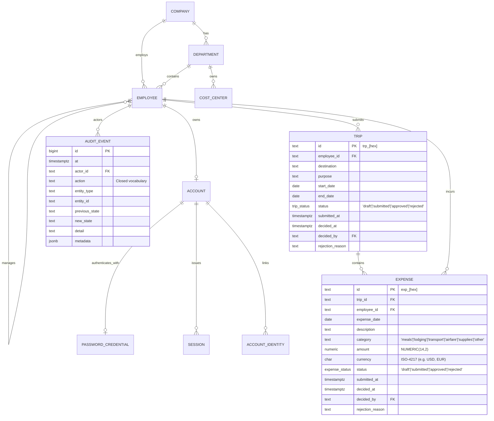

# Trek Data Model & Database Schema

## 1. Entity-Relationship Overview

---

## 2. Table Specifications

### 2.1 Core Identity & Organization

#### `company`
* `id` (`text`, Primary Key, e.g. `'co_trek'`)
* `name` (`text`, NOT NULL)
* `currency` (`char(3)`, Default `'SAR'`)
* `created_at` (`timestamptz`, Default `now()`)

#### `department`
* `id` (`text`, Primary Key, e.g. `'dep_sls'`)
* `company_id` (`text`, Foreign Key &rarr; `company(id)`)
* `code` (`text`, NOT NULL, Unique)
* `name` (`text`, NOT NULL)
* `head_id` (`text`, Foreign Key &rarr; `employee(id)`, Nullable)
* `active` (`boolean`, Default `true`)

#### `cost_center`
* `id` (`text`, Primary Key, e.g. `'cc_ccsls01'`)
* `company_id` (`text`, Foreign Key &rarr; `company(id)`)
* `department_id` (`text`, Foreign Key &rarr; `department(id)`)
* `code` (`text`, NOT NULL, Unique)
* `name` (`text`, NOT NULL)
* `active` (`boolean`, Default `true`)

#### `employee`
* `id` (`text`, Primary Key, e.g. `'emp_1000'`)
* `company_id` (`text`, Foreign Key &rarr; `company(id)`)
* `employee_code` (`text`, NOT NULL, Unique uppercase, e.g. `'GP-0231'`)
* `name` (`text`, NOT NULL)
* `work_email` (`text`, NOT NULL, Unique lowercase)
* `mobile` (`text`, Nullable)
* `department_id` (`text`, Foreign Key &rarr; `department(id)`)
* `cost_center_id` (`text`, Foreign Key &rarr; `cost_center(id)`)
* `designation` (`text`, NOT NULL)
* `grade` (`text`, Check `grade IN ('G1','G2','G3','G4','G5','G6')`)
* `manager_id` (`text`, Foreign Key &rarr; `employee(id)`, Check `manager_id <> id`)
* `location` (`text`, NOT NULL)
* `joining_date` (`date`, NOT NULL)
* `status` (`employee_status`: `'active' | 'inactive'`)
* `roles` (`text[]`, Check roles subset of `{'employee', 'manager', 'hr_travel', 'finance', 'admin'}`)

---

### 2.2 Authentication & Sessions

#### `account`
* `id` (`text`, Primary Key, e.g. `'acc_[hex]'`)
* `company_id` (`text`, Foreign Key &rarr; `company(id)`)
* `employee_id` (`text`, Unique, Foreign Key &rarr; `employee(id)`)
* `status` (`account_status`: `'active' | 'suspended'`)
* `last_login_at` (`timestamptz`)

#### `password_credential`
* `account_id` (`text`, Primary Key, Foreign Key &rarr; `account(id)` ON DELETE CASCADE)
* `hash` (`text`, NOT NULL, Scrypt password hash)
* `changed_at` (`timestamptz`, Default `now()`)

#### `login_attempt`
* `id` (`bigserial`, Primary Key)
* `email` (`text`, NOT NULL)
* `ip` (`inet`, NOT NULL)
* `success` (`boolean`, NOT NULL)
* `at` (`timestamptz`, Default `now()`)

#### `session`
* `id` (`text`, Primary Key, 32-byte crypto random string)
* `account_id` (`text`, Foreign Key &rarr; `account(id)` ON DELETE CASCADE)
* `employee_id` (`text`, Foreign Key &rarr; `employee(id)`)
* `created_at` (`timestamptz`, Default `now()`)
* `expires_at` (`timestamptz`, NOT NULL)
* `last_active_at` (`timestamptz`, Default `now()`)

---

### 2.3 Travel & Expense (Pilot Core)

#### `trip`
Represents an employee's business travel request.
* `id` (`text`, Primary Key, Default `'trp_' || encode(gen_random_bytes(8), 'hex')`)
* `company_id` (`text`, Foreign Key &rarr; `company(id)`)
* `employee_id` (`text`, NOT NULL, Foreign Key &rarr; `employee(id)`)
* `destination` (`text`, NOT NULL)
* `purpose` (`text`, NOT NULL)
* `start_date` (`date`, NOT NULL)
* `end_date` (`date`, NOT NULL)
* `currency` (`char(3)`, NOT NULL, Default `'USD'`, ISO-4217 code)
* `status` (`trip_status`: `'draft' | 'submitted' | 'approved' | 'rejected'`)
* `submitted_at` (`timestamptz`)
* `decided_at` (`timestamptz`)
* `decided_by` (`text`, Foreign Key &rarr; `employee(id)`)
* `rejection_reason` (`text`, Nullable)
* `created_at` (`timestamptz`, Default `now()`)
* `updated_at` (`timestamptz`, Default `now()`)
* **Constraints**:
  * `CHECK (end_date >= start_date)`
* **Indexes**:
  * `(employee_id, created_at DESC)`
  * `(status)`

#### `expense`
Represents an individual itemized expense incurred during a trip.
* `id` (`text`, Primary Key, Default `'exp_' || encode(gen_random_bytes(8), 'hex')`)
* `company_id` (`text`, Foreign Key &rarr; `company(id)`)
* `trip_id` (`text`, NOT NULL, Foreign Key &rarr; `trip(id)` ON DELETE CASCADE)
* `employee_id` (`text`, NOT NULL, Foreign Key &rarr; `employee(id)`)
* `expense_date` (`date`, NOT NULL)
* `description` (`text`, NOT NULL)
* `category` (`text`, NOT NULL, One of: `'meals'`, `'lodging'`, `'transport'`, `'airfare'`, `'supplies'`, `'other'`)
* `amount` (`numeric(14,2)`, NOT NULL)
* `currency` (`char(3)`, NOT NULL, ISO-4217 code)
* `status` (`expense_status`: `'draft' | 'submitted' | 'approved' | 'rejected'`)
* `submitted_at` (`timestamptz`)
* `decided_at` (`timestamptz`)
* `decided_by` (`text`, Foreign Key &rarr; `employee(id)`)
* `rejection_reason` (`text`, Nullable)
* `created_at` (`timestamptz`, Default `now()`)
* `updated_at` (`timestamptz`, Default `now()`)
* **Constraints**:
  * `CHECK (amount > 0)`
* **Indexes**:
  * `(trip_id, created_at DESC)`
  * `(employee_id, created_at DESC)`
  * `(status)`

---

### 2.4 Immutable Audit Log

#### `audit_event`
Append-only log of all security, administrative, and domain operations.
* `id` (`bigserial`, Primary Key)
* `company_id` (`text`, Foreign Key &rarr; `company(id)`)
* `at` (`timestamptz`, Default `now()`)
* `actor_id` (`text`, Foreign Key &rarr; `employee(id)`)
* `actor_label` (`text`)
* `action` (`text`, NOT NULL)
* `entity_type` (`text`, NOT NULL)
* `entity_id` (`text`, NOT NULL)
* `previous_state` (`text`)
* `new_state` (`text`)
* `detail` (`text`, NOT NULL)
* `reason` (`text`)
* `metadata` (`jsonb`, Default `'{}'::jsonb`)
* `request_id` (`text`)
* `actor_ip` (`inet`)
* **Database Triggers**:
  * `audit_event_no_update`: Raises exception on `UPDATE`.
  * `audit_event_no_delete`: Raises exception on `DELETE`.

---

## 3. Migration Register

Migrations are forward-only, sequentially numbered SQL scripts located in `migrations/`.

1. `001_core_identity.sql`: Company, department, cost center, employee, account, and session tables.
2. `002_audit.sql`: Append-only `audit_event` table and PostgreSQL immutability triggers.
3. `003_seed_master_data.sql`: Base organization bootstrap data.
4. `004_password_auth.sql`: Scrypt credentials, reset tokens, and brute-force tracking (`login_attempt`).
5. `005_remove_demo_employees.sql`: Forward cleanup removing legacy demo fixtures, leaving only the initial administrator account (`ashishreddy@garageplug.com`).
6. `006_trips_and_expenses.sql`: Enums, tables, check constraints, indexes, triggers, and runtime role grants for Trips and Expenses.
7. `007_trip_currency.sql`: Adds destination `currency` column to `trip` table for international multi-currency travel planning.
